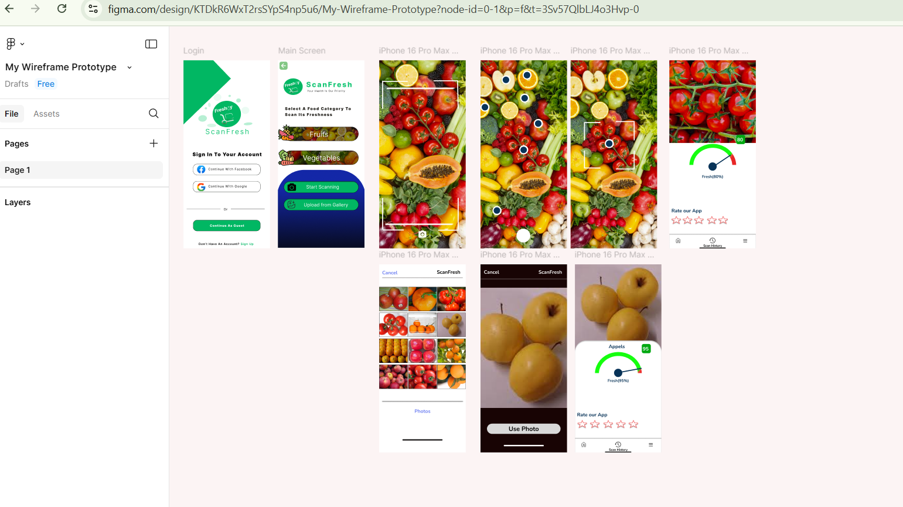
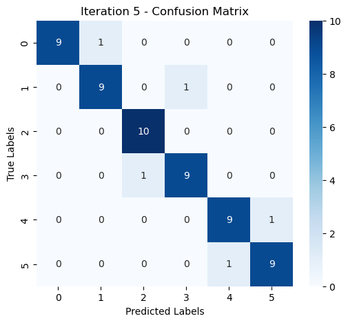
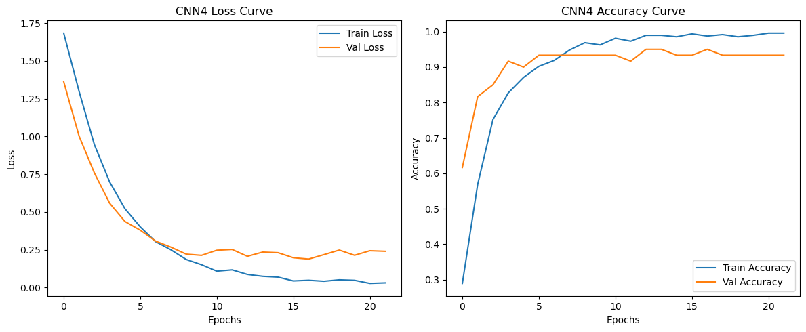
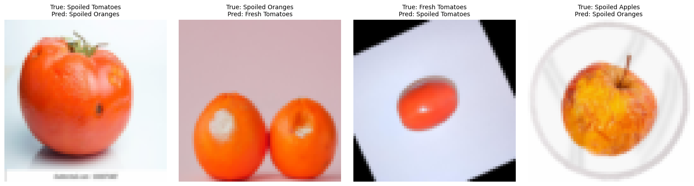
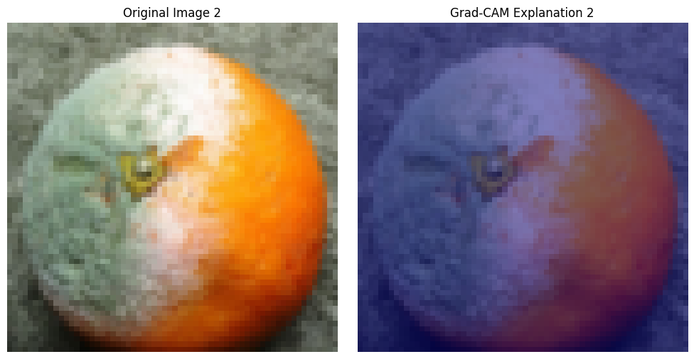
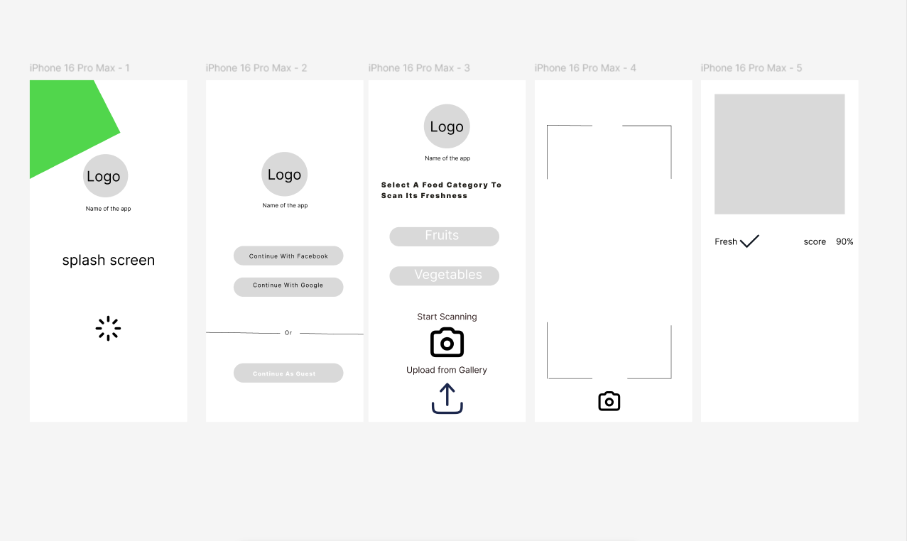
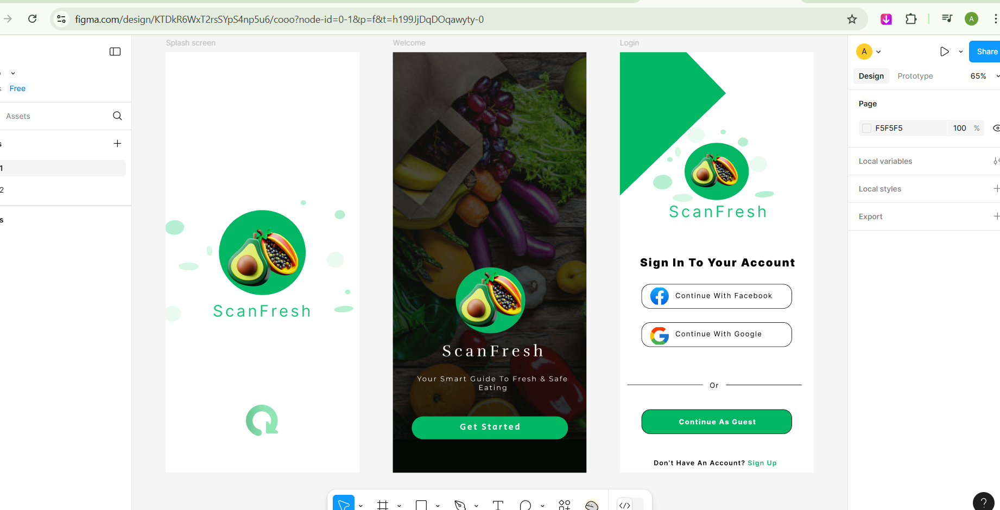

# ScanFresh: Food Freshness Classification with Deep Learning

**ScanFresh** is an app concept that tells you whether fruit is **fresh or spoiled** from a photo.
This project covers the full journey: **market research → a CNN trained on my own image dataset → bias & explainability analysis → app prototype tested with real users**.

| | |
|---|---|
| **Task** | 6-class image classification: fresh / spoiled × apples, oranges, tomatoes |
| **Data** | 600 self-collected images (100 per class) from Kaggle, web scraping and generative AI |
| **Best model** | EfficientNetB0 (transfer learning) + data augmentation |
| **Result** | **95 % test accuracy** (`model.evaluate`), 92 % in the classification report, on par with human-level performance (94 %) |

**Tech stack:** Python · TensorFlow/Keras · scikit-learn · Xplique (Grad-CAM, Integrated Gradients) · LIME / SHAP · pandas · SciPy · Figma



---

## 1. Business understanding

About **1.3 billion tons of food** are wasted every year (FAO), partly because people and retailers can't reliably judge freshness: good fruit gets thrown away and spoiled fruit gets sold.
I analysed the market, stakeholders and existing solutions, and designed the product with a **DAPS diagram** (Data → Analysis → Prediction → Solution).

[Business understanding report](docs/business_understanding.pdf) · [DAPS diagram](docs/daps_diagram.svg)

---

## 2. Deep learning: from baseline to 95 %

I first set baselines, then improved the model one change at a time so each step's effect is measurable:

| Step | Model | Test accuracy |
|---|---|---|
| Baseline | Random guess (6 classes) | 16.7 % |
| Baseline | Multilayer perceptron | 70.0 % |
| Iteration 1 | Basic CNN (BatchNorm, MaxPooling, Dropout) | 85.0 % |
| Iteration 2 | CNN + data augmentation | 86.7 % |
| Iteration 3 | Transfer learning: MobileNet (top layers fine-tuned) | 90.0 % |
| Iteration 4 | MobileNet + data augmentation | 93.3 % |
| **Iteration 5** | **EfficientNetB0 + data augmentation** | **95.0 %** |
| Benchmark | **Human-level performance** (3 people, 60-image survey) | 94.0 % |

| Confusion matrix (EfficientNetB0) | Learning curves |
|---|---|
|  |  |

### Error analysis



The remaining mistakes are mostly **spoiled fruit with very small damage**, **distracting backgrounds** (pink, bright white) and **shadows/lighting**. Next steps I identified: simplify to 2 classes (fresh vs. spoiled), collect more images with clear damage, and use gentler augmentation (less zoom, which can crop out the spoiled spot).

[Deep learning notebook](notebooks/1_deep_learning_food_freshness.ipynb)

---

## 3. Responsible AI

- **Bias analysis (ImSitu dataset):** found gender stereotypes, e.g. men shown driving trucks for work vs. women driving cars casually (98 vs. 61 images), and men cleaning with tools vs. women cleaning in kitchens. Proposed *Fairness Through Awareness* to correct it.
- **Group fairness metrics:** demographic parity, equalized odds and calibration, explained in an [infographic](docs/fairness_metrics_infographic.pdf) and computed in a [practical notebook](extras/explainable-ai/group_fairness_metrics.ipynb).
- **Explainable AI:** applied **Grad-CAM** and **Integrated Gradients** to my CNN to check *where* it looks when it decides.



*Grad-CAM on a spoiled orange. Grad-CAM gave the clearer big-picture view of where the model looks; Integrated Gradients showed more pixel-level detail but was noisier and more sensitive to lighting and background. Both are compared in the notebook.*

[Responsible AI notebook](notebooks/2_responsible_ai_bias_and_xai.ipynb)

---

## 4. Human-centered design & user testing

1. **Wireframes:** low-fidelity sketches → high-fidelity Figma prototype (two versions, A and B)
2. **Think-aloud study** (3 participants): users found the app clean and simple, but wanted clearer **feedback during scanning**, **guidance on login** and **explanations of the result** (what does "80 % fresh" mean?)
3. **A/B test** (38 participants, 7-point questionnaire): **Version B scored higher on all 5 questions** (understanding, intuitiveness, usefulness, enjoyment, scanning speed)

| Low-fidelity wireframe | Splash & login screens |
|---|---|
|  |  |

[Human-centered AI report](docs/human_centered_ai.pdf) · [A/B test analysis](notebooks/3_ab_test_analysis.ipynb) · [Demo video](docs/demo_video.mp4) · [Think-aloud transcripts](data/think_aloud/)

---

## Repository structure

```
food-freshness-cnn/
├── notebooks/
│   ├── 1_deep_learning_food_freshness.ipynb   # baselines → CNN → transfer learning → error analysis
│   ├── 2_responsible_ai_bias_and_xai.ipynb    # bias analysis, fairness, Grad-CAM, Integrated Gradients
│   └── 3_ab_test_analysis.ipynb               # assumption checks, t-tests, bootstrapping
├── models/basic_cnn.h5                        # trained CNN used for the XAI analysis
├── data/
│   ├── X_test_cnn.npy                         # preprocessed test images for the XAI notebook
│   ├── ab_test/                               # anonymised A/B questionnaire results
│   ├── think_aloud/                           # anonymised think-aloud transcripts
│   └── bias_images/                           # ImSitu examples used in the bias analysis
├── docs/                                      # reports (PDF), DAPS diagram, infographic, demo video
├── assets/                                    # images used in this README
├── extras/
│   ├── deep-learning/                         # MLPs (incl. from scratch), gradient descent, convolution, augmentation
│   └── explainable-ai/                        # Grad-CAM++, LIME, SHAP, saliency maps, adversarial attacks
└── certificates/                              # DataCamp & LinkedIn Learning certificates
```

## How to run

```bash
pip install -r requirements.txt
jupyter notebook notebooks/
```

- The **Responsible AI** and **A/B test** notebooks run directly with the files in this repo.
- The **Deep learning** notebook needs the image dataset, which is not included. Place it in `data/Image_Dataset/<class name>/`.
- The `extras/explainable-ai` exercises use a cats-vs-dogs dataset, expected in `./cats_and_dogs/`.

---

## Reflection: what I would do differently now

- **One consistent test metric.** For the final model, `model.evaluate` reports 95 % while the confusion matrix gives 55/60 = 92 %. With only 60 test images, one image is worth 1.7 percentage points; I'd use a larger test set (or cross-validation) and a single evaluation path.
- **A/B test statistics.** The bootstrapped p-values all came out at ≈ 0.5, yet the 95 % confidence intervals for 4 of the 5 questions do not include zero. That points to an error in how I computed the bootstrap p-value: Version B was most likely *significantly* better on those 4 questions.
- **Better explanations.** Grad-CAM on a small 64×64 CNN gives coarse heatmaps; applying it to the EfficientNet model would be more informative.

---

## Certificates

Courses completed during this project: [Image Modeling with Keras (DataCamp)](certificates/Image%20Modeling%20with%20Keras%20(DataCamp).pdf) · [Design Thinking](certificates/Design%20Thinking%20Understanding%20the%20Process%20(LinkedIn%20Learning).pdf) · [UX Foundations: Interaction Design](certificates/UX%20Foundations%20Interaction%20Design%20(LinkedIn%20Learning).pdf) · [UX Foundations: Usability Testing](certificates/UX%20Foundations%20Usability%20Testing%20(LinkedIn%20Learning).pdf) · [Interaction Design: Flow](certificates/Interaction%20Design%20Flow%20(LinkedIn%20Learning).pdf) · [Interaction Design: Interface](certificates/Interaction%20Design%20Interface%20(LinkedIn%20Learning).pdf) · [Public Speaking Foundations](certificates/Public%20Speaking%20Foundations%20(LinkedIn%20Learning).pdf) · [Excel courses (6)](certificates/)

---

Built in Year 1 of the Applied Data Science & AI programme at Breda University of Applied Sciences.
**Author:** Ahmed Ali Alezabi · [GitHub](https://github.com/AhmedAlezabi1)
